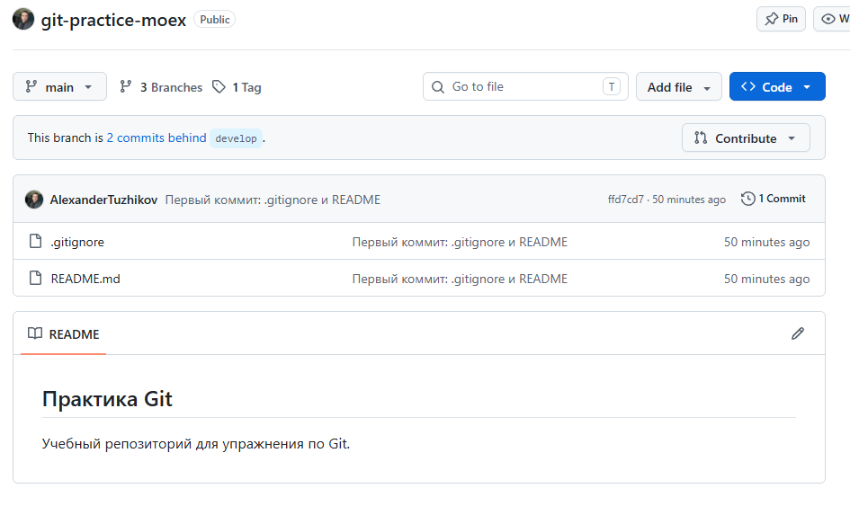
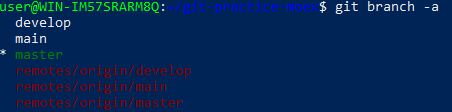
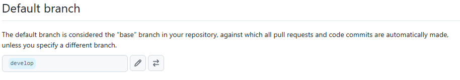
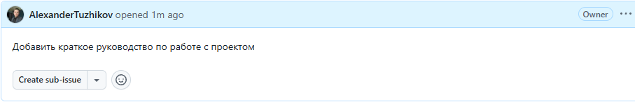
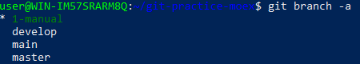
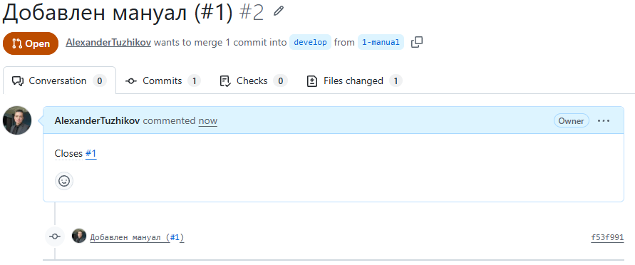
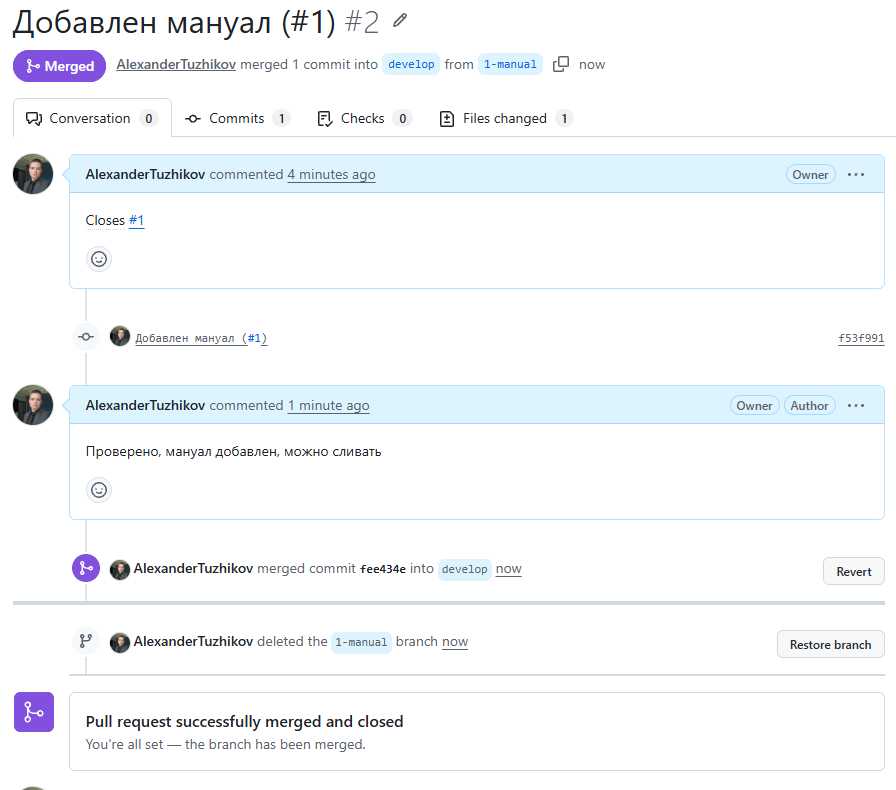
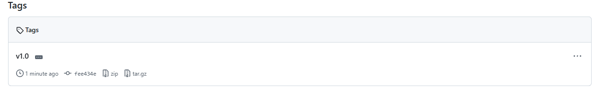
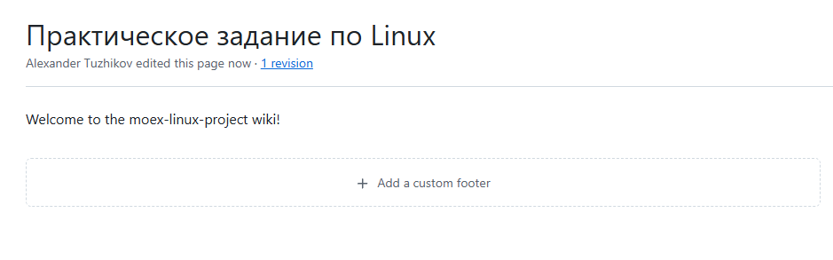

Репозиторий для упражнения: https://github.com/AlexanderTuzhikov/git-practice-moex

На GitHub merge request называется pull request, в отчёте использован этот термин.

## 1. создание личного репозитория с нужным .gitignore и простым README.MD

Создан пустой репозиторий `git-practice-moex` на GitHub, склонирован по SSH. Добавлены `.gitignore` (секреты, данные, журналы, служебные папки Python) и `README.md` с заголовком второго уровня. Первый коммит отправлен на GitHub.

```bash
git clone git@github.com:AlexanderTuzhikov/git-practice-moex.git
git add .gitignore README.md
git commit -m "Первый коммит: .gitignore и README"
git push -u origin main
```



## 2. создание веток develop и master

Созданы ветки `develop` и `master`, обе отправлены на GitHub. Ветка `main` появилась сама при клонировании пустого репозитория.

```bash
git switch -c develop
git push -u origin develop
git branch -a
```



## 3. установка ветки develop по умолчанию

В настройках репозитория на GitHub (Settings, Branches, Default branch) ветка по умолчанию изменена на `develop`.



## 4. создание issue на создание текущего мануала

Создан issue `#1` «Создать мануал по проекту» во вкладке Issues.



## 5. создание ветки по issue

От `develop` создана ветка `1-manual` (по номеру issue), в ней добавлен файл `MANUAL.md`, изменения отправлены на GitHub.

```bash
git switch develop
git pull
git switch -c 1-manual
git add MANUAL.md
git commit -m "Добавлен мануал (#1)"
git push -u origin 1-manual
```



## 6. создание merge request по ветке в develop

Создан pull request `#2` из ветки `1-manual` в `develop` (base: `develop`), в описании указано `Closes #1`.



## 7. комментирование и принятие реквеста

В pull request оставлен комментарий, затем он принят (Merge pull request). Issue `#1` закрылся автоматически.



## 8. формирование стабильной версии в master с простановкой тега

Изменения из `develop` слиты в `master` (fast-forward), на коммит поставлен аннотированный тег `v1.0`. Тег отправлен отдельной командой, потому что обычный `push` теги не отправляет.

```bash
git switch master
git merge develop
git push origin master
git tag -a v1.0 -m "Стабильная версия"
git push origin v1.0
```



## 9. работа с wiki проекта

Включена вкладка Wiki в настройках репозитория, создана первая страница.


